# Sessions History (`/riwayat` & `/riwayat/[id]`) — FE ↔ BE Integration Spec

- **Status:** In Implementation — Phase 1 assessment + Phase 2 spec approved. Implementation on task branch `feature/psr-121-riwayat-ship-member-history-integration`.
- **Date:** 2026-11-07
- **Scope:** Member History module only: `/riwayat` (session history list, filters, cursor pagination, summary stats) and `/riwayat/[id]` (session detail: coach review, body assessments, evaluation telemetry, video playback, follow-up tasks, acknowledge & retry actions).
- **Out of scope:** Coach member history (`/coach/members/[id]/riwayat` — deferred to the Coach module integration run), coach review authoring/publishing (`PUT /feedback-draft`, `POST /reviews`), pose-skeleton canvas overlay (`GET /pose`), chart libraries.
- **BE source of truth:** `https://silatsense-be.vercel.app/openapi.json` (v0.7.0, fetched 2026-11-07).
- **FE baseline:** Next.js 16.3.8 (`cacheComponents: true`), React 19.2.8, TanStack Query 5.104.1, Zod 4.6.5, `@hey-api/openapi-ts` 0.99.0 generated client in `src/api/`.
- **Canonical conventions:** [`docs/integration/README.md`](./README.md) and [`docs/integration/Training.md`](./Training.md).

---

## 0. TL;DR

Both Member History screens (`/riwayat` and `/riwayat/[id]`) currently run on **100% static dummy stubs** (`riwayat-dummy.ts`, `session-detail-dummy.ts`) behind Next.js 16 `'use cache'` + `cacheLife("minutes")` readers and static `generateStaticParams()`.

Integrating against the live OpenAPI contract requires resolving four structural mismatches between the Figma-derived FE stubs and the BE wire contract:

1. **`/riwayat` is a cursor-paginated chronological session log, not 4 fixed movement cards.**
   - Current FE renders 4 hardcoded collapsible cards (one per pillar: `kuda-kuda`, `pukulan`, `tangkisan`, `tendangan`) with 5 posture chips (`bahu`, `siku-kanan`, `pinggul`, `lutut`, `pergelangan`) inside each card.
   - BE `GET /api/v1/member/history` returns `HistoryPage { items: HistoryItem[], nextCursor: string | null }` with query filters (`limit`, `cursor`, `movementSlug`, `processingStatus`, `reviewStatus`, `from`, `to`). Each `HistoryItem` carries `{ session: SessionOut, movementName, score, scoreReason, review?: PublishedReview | null }` — it does **not** embed `EvaluationOut.measurements`.
   - **Decision (D1):** Adapt `/riwayat` to render the cursor-paginated/filtered session list from `GET /api/v1/member/history`. Expandable card bodies render `review.bodyAssessments` (when a coach review exists), `review.note` / `scoreReason`, and link `Detail Evaluasi` to `/riwayat/${session.id}`.

2. **`GET /api/v1/member/history` does not return summary statistics for `RiwayatStatGrid`.**
   - Current FE expects 4 summary cards (`Total Sesi`, `Rata-rata Akurasi`, `Fokus Dominan`, `Jam Sensor`) from `getRiwayat()`.
   - BE exposes `ActivitySummary` (`completedSessionCount`, `totalDurationSeconds`, `scoredSessionCount`, `similarityGroups`) and `dominantMovementSlug` on `GET /api/v1/member/dashboard` (`Dashboard`).
   - **Decision (D2):** `StatsSection` on `/riwayat` reads `GET /api/v1/member/dashboard` (via a shared `cache()` reader) to populate the 3 BE-supported tiles (`Total Sesi`, `Fokus Dominan`, `Jam Latihan` from `totalDurationSeconds`), and renders `Rata-rata Akurasi` (plus `sessionsDeltaLabel`) as visually inactive with a `"Segera hadir"` badge per [`README.md`](./README.md) §6.1.

3. **`/riwayat/[id]` (`SessionDetail`) exposes coach reviews, AI evaluations, legacy notes, and follow-up tasks — not a 4-pillar IPSI pass/fail matrix or retest schedule.**
   - Current FE `SessionKelayakanCard` displays a 4-pillar pass/fail grid (`91% Lolos`, `86% Lolos`, `80% Fokus`, `76% Remidi`), an `85%` pass threshold, and `"Jadwal Uji Ulang: Jumat, 2 Okt 2026 • Dojo UNSIL"`. None of these exist in BE `SessionDetail`.
   - Meanwhile, BE `GET /api/v1/member/history/{session_id}` returns `SessionDetail { session, evaluation, coach, review, reviewHistory, legacyNotes, followUpTasks }`, and exposes `PATCH /api/v1/member/follow-up-tasks/{task_id}` (`TaskPatch { status: 'completed' | 'dismissed' }`).
   - **Decision (D3 & D4):** Adapt `SessionKelayakanCard` to honest UI: display the session's similarity score in `poin` (`0–100`, no `%` or `85%` pass threshold per `Training.md` D5), render per-pillar `similarityGroups` from `Dashboard.statistics` (when available) or inactive `"Segera hadir"` slots for cross-pillar eligibility and `Jadwal Uji Ulang`, and render `followUpTasks` with live completion/dismissal toggles wired to `PATCH /api/v1/member/follow-up-tasks/{task_id}`.

4. **`/riwayat/[id]` video and bottom CTAs are currently dead placeholders.**
   - Current FE `SessionVideoPlaceholder` renders a static dark box, and `SessionDetailActions` has a dead `Konfirmasi Telah Membaca` span (`TODO: POST /member/remedial`) and a hardcoded `/latihan/pukulan/rekam` link.
   - **Decision (D5 & D6):** Reuse the authenticated BFF video stream route (`/api/member/sessions/${session.id}/video`) and `SesiPlayback` / `MediaUnavailable` states from the Training module; wire `Konfirmasi Telah Membaca` to `acknowledgeSessionAction` (`POST /api/v1/member/sessions/{session_id}/acknowledge`) and `Mulai Remedial` to `retrySessionAction` (`POST /api/v1/member/sessions/{session_id}/follow-ups`) → `/latihan/${session.movementSlug}/rekam?retryOf=${retryId}`.

---

## 1. Phase 1 Assessment — Current FE Inventory

### 1.1 Routes and Page Compositions

| Route | Route File | Layout / Nav | Feature Page Composition | Current Behavior |
|---|---|---|---|---|
| `/riwayat` | `app/(member)/riwayat/page.tsx` | `app/(member)/riwayat/layout.tsx` (`MemberLayout activeTab="riwayat" trail={["Dashboard", "Riwayat Latihan"]}`) wrapped by `app/(member)/layout.tsx` (`AuthGate role="member"`) | `features/member/pages/riwayat-page.tsx` (`RiwayatPage`) | Two `<Suspense>` boundaries (`StatsSection` + `MovementsSection`), both calling `getRiwayat()` which returns `dummyMemberHistory`. Accepts no `searchParams`. |
| `/riwayat/[id]` | `app/(member)/riwayat/[id]/page.tsx` | Inherits `app/(member)/riwayat/layout.tsx` | `features/member/pages/session-detail-page.tsx` (`SessionDetailPage`) | Exports `generateStaticParams()` over `sessionDetailIds` (`["pukulan-menunggu", "pukulan-remidiasi"]`). Five `<Suspense>` boundaries (`CoachSection`, `KelayakanSection`, `VisualSection`, `PostureSection`, `ActionsSection`) calling `getSessionDetail(id)`. Calls `notFound()` if `null`. |

### 1.2 Components & Hooks in `{History/Riwayat}`

| Component File | Server / Client | Props | Current Responsibility & Assumed Data |
|---|---|---|---|
| `features/member/components/riwayat-stat-grid.tsx` | Server | `{ summary: HistorySummary }` | Renders 2×2 `Card` grid: `Total Sesi`, `Rata-rata Akurasi` (`${avgAccuracyPct}%`), `Fokus Dominan`, `Jam Sensor`. |
| `features/member/components/riwayat-movement-list.tsx` | Server | `{ entries: HistoryEntry[] }` | Renders section `"Daftar 4 Gerakan Utama"` and maps `entries` into `RiwayatMovementItem` wrapping `RiwayatParamChips`, `RiwayatCoachNote`, and `RiwayatCardActions`. |
| `features/member/components/riwayat-movement-item.tsx` | Client (`"use client"`) | `{ entry: HistoryEntry; children: ReactNode }` | Uses `useState(false)` with `@/components/ui/collapsible` (`Collapsible`, `CollapsibleTrigger`, `CollapsibleContent`). Displays icon by `entry.slug`, `techniqueName`, `dateLabel • timeLabel`, `summary`, status `Badge`, `scorePct%`, and `scoreCaption`. |
| `features/member/components/riwayat-param-chips.tsx` | Server | `{ params: RiwayatParam[] }` | 2-col grid of 5 posture chips (`pergelangan` spans 2 cols). Tints deviated chips with warning classes and optional `actionLabel`. |
| `features/member/components/riwayat-coach-note.tsx` | Server | `{ note: string }` | Renders `"Catatan Pelatih: "` + `note`. |
| `features/member/components/riwayat-card-actions.tsx` | Server | `{ slug: RiwayatSlug }` | Renders live `<Link href="/latihan/${slug}/rekam">Latihan Ulang</Link>` and a dead `<span aria-disabled="true">Detail Evaluasi</span>` with `TODO (GET /member/history/:id)`. |
| `features/member/components/session-coach-card.tsx` | Server | `{ session: SessionDetail }` | Renders coach initials block (`session.coach.initials`), name, role, hardcoded `<Badge variant="warning">Menunggu</Badge>` (ignores `session.decisionLabel`), and conditional `isRemidiasi` box (`decidedAtLabel`, `"Tahap remidiasi teknis"`, `focusTechnique`). |
| `features/member/components/session-kelayakan-card.tsx` | Server | `{ session: SessionDetail }` | Renders `"Status Kelayakan Tanding"`, `<Badge variant="outline">IPSI CLASS B</Badge>`, warning banner (`scorePct%` vs `targetPct%`), 2×2 `session.pillars` stage grid, hardcoded graduation bullets, and `retestLabel` + `retestValue`. |
| `features/member/components/session-video-placeholder.tsx` | Server | `{ session: SessionDetail }` | Renders `Card` with `techniqueName`, `techniqueDesc`, and a static 16:9 dark box with a `Video` icon (`TODO: GET /member/history/:id`). |
| `features/member/components/session-posture-list.tsx` | Server | `{ session: SessionDetail }` | Renders `"Catatan Pelatih"`, shared `ScoreRing` (`sesuai / total`), empty state `"Belum ada catatan dari pelatih"` when `postures.length === 0`, or maps `SessionPostureItem`. |
| `features/member/components/session-posture-item.tsx` | Server | `{ posture: PostureAssessment }` | Renders posture item with `Badge`, `"Catatan: " + posture.detail`, and conditional `"Koreksi: " + posture.correctionCue`. Special-cases `posture.id === "siku-kanan"` as destructive/critical. |
| `features/member/components/session-detail-actions.tsx` | Server | `{}` (none) | Renders `"Siap Melakukan Remediasi?"`, dead `<span aria-disabled="true">Konfirmasi Telah Membaca</span>` (`TODO: POST /member/remedial`), and hardcoded `<Link href="/latihan/pukulan/rekam">Mulai Remedial Pukulan Sekarang</Link>`. |

**Hooks:** None in `features/member/hooks/` are used by `/riwayat` or `/riwayat/[id]`. Only `useState(false)` is used inside `riwayat-movement-item.tsx`.

### 1.3 Local Types, Zod Schemas, Mocks/Fixtures, and Data Fetching

- **Local Types (`features/member/types.ts` lines 263–352):**
  - `PostureStatus = "sesuai" | "perlu-koreksi"`
  - `PostureAssessment { id: PostureParamId; name: string; status: PostureStatus; statusLabel: string; reading: string; detail: string; correctionCue: string; thumbnailLabel: string; thumbnailSrc: null }`
  - `RiwayatSlug = PersiapanSlug` (`"kuda-kuda" | "pukulan" | "tangkisan" | "tendangan"`)
  - `HistoryStatus = "sesuai" | "perlu-koreksi"`
  - `RiwayatParam { id: PostureParamId; name: string; reading: string; deviated: boolean; actionLabel?: string }`
  - `HistoryEntry { slug: RiwayatSlug; techniqueName: string; dateLabel: string; timeLabel: string; summary: string; status: HistoryStatus; statusLabel: string; scorePct: number; scoreCaption: string; params: RiwayatParam[]; coachNote: string }`
  - `HistorySummary { totalSessionsLabel: string; sessionsDeltaLabel: string; avgAccuracyPct: number; accuracyNote: string; dominantFocus: string; dominantSessionsLabel: string; sensorHoursLabel: string; sensorNote: string }`
  - `MemberHistory { summary: HistorySummary; entries: HistoryEntry[] }`
  - `SessionDecision = "menunggu" | "remidiasi"`
  - `SessionPillar { id: PilarSlug; name: string; detail: string; scorePct: number; stageLabel: "Lolos" | "Fokus" | "Remidi"; badge: "success" | "destructive" | "warning" }`
  - `SessionVideo { status: "placeholder"; cameraLabel: string; qualityLabel: string }`
  - `SessionDetail { id: string; techniqueName: string; techniqueDesc: string; coach: { initials: string; name: string; role: string }; decision: SessionDecision; decisionLabel: string; decidedAtLabel?: string; focusTechnique?: string; scorePct: number; targetPct: number; pillars: SessionPillar[]; video: SessionVideo; postures: PostureAssessment[]; retestLabel: string; retestValue: string }`
- **Local Zod Schemas:**
  - None exist for history filters, pagination, or `follow-up-tasks`.
  - `features/member/schemas/recording.ts` already defines `sessionIdSchema`, `idempotencyKeySchema`, `sessionIdInputSchema`, and `retrySessionInputSchema` (created in Phase 15 Training).
- **Mocks / Fixtures & Tests:**
  - `features/member/data/riwayat-dummy.ts` (`dummyMemberHistory`)
  - `features/member/data/session-detail-dummy.ts` (`beforeSessionDetail`, `afterSessionDetail`, `sessionDetailIds`)
  - `tests/unit/member/riwayat-data.test.ts` & `tests/unit/member/riwayat-shell.test.ts`
  - `tests/unit/member/session-detail-data.test.ts` & `tests/unit/member/session-detail-shell.test.ts`
- **Data Fetching & Assumed Endpoints:**
  - `features/member/data/get-riwayat.ts`: `'use cache'` + `cacheLife("minutes")`, assumes `GET /member/history` returning `MemberHistory` (`{ summary, entries[4] }`).
  - `features/member/data/get-session-detail.ts`: `'use cache'` + `cacheLife("minutes")`, assumes `GET /member/history/:id` returning local `SessionDetail`.
  - `features/member/components/session-detail-actions.tsx`: assumes `POST /member/remedial` (does not exist in BE).

---

## 2. Phase 1 Assessment — Backend Contract Snapshot

### 2.1 Endpoints Relevant to Member History

All endpoints require `HTTPBearer` (`Authorization: Bearer <accessToken>`). Error responses use `DomainErrorOut`.

| # | Method + Path | Params / Query / Headers | Request Body | Success Response | Error Statuses | Generated SDK Function |
|---|---|---|---|---|---|---|
| 1 | `GET /api/v1/member/history` | Query: `limit?: 1..100` (default `20`), `cursor?: string \| null` (max `4096`), `movementSlug?: 'kuda-kuda' \| 'pukulan' \| 'tangkisan' \| 'tendangan' \| null`, `processingStatus?: 'queued' \| 'processing' \| 'completed' \| 'failed' \| null`, `reviewStatus?: 'pending' \| 'needs_revision' \| 'approved' \| null`, `from?: ISO datetime \| null`, `to?: ISO datetime \| null` | — | `200 HistoryPage` | `401, 403, 404, 422, 500` | `historyApiV1MemberHistoryGet` |
| 2 | `GET /api/v1/member/history/{session_id}` | Path: `session_id: string` | — | `200 SessionDetail` | `401, 403, 404, 422, 500` | `detailApiV1MemberHistorySessionIdGet` |
| 3 | `GET /api/v1/member/dashboard` | — | — | `200 Dashboard` | `401, 403, 404, 422, 500` | `dashboardApiV1MemberDashboardGet` |
| 4 | `PATCH /api/v1/member/follow-up-tasks/{task_id}` | Path: `task_id: string` | `TaskPatch { status: 'completed' \| 'dismissed' }` | `200 TaskOut` | `401, 403, 404, 409, 410, 416, 422, 500` | `taskApiV1MemberFollowUpTasksTaskIdPatch` |
| 5 | `POST /api/v1/member/sessions/{session_id}/acknowledge` | Path: `session_id: string` | — | `200 AcknowledgedOut` | `401, 403, 404, 409, 410, 413, 415, 416, 422, 429, 500, 503` | `acknowledgeSessionApiV1MemberSessionsSessionIdAcknowledgePost` |
| 6 | `POST /api/v1/member/sessions/{session_id}/follow-ups` | Path: `session_id: string`; Header: `Idempotency-Key` (`1..128` chars) | `RetryInput { intent: 'retry' }` | `201 RetryOut` | `401, 403, 404, 409, 410, 416, 422, 500` | `retryApiV1MemberSessionsSessionIdFollowUpsPost` |
| 7 | `DELETE /api/v1/member/sessions/{session_id}` | Path: `session_id: string` | — | `204 void` | `401, 403, 404, 409, 410, 413, 415, 416, 422, 429, 500, 503` | `removeSessionApiV1MemberSessionsSessionIdDelete` |
| 8 | `GET /api/v1/member/sessions/{session_id}/video` | Path: `session_id: string`; Header: `Range?: string \| null` | — | `200` / `206` binary (`video/mp4 \| video/quicktime \| video/webm`) | `401, 403, 404, 409, 410, 413, 415, 416, 422, 429, 500, 503` | Proxied via `GET /api/member/sessions/[sessionId]/video` (`client.get` stream) |

### 2.2 Pagination and Filter Conventions (`GET /api/v1/member/history`)

- **Cursor pagination:** Opaque cursor string (`cursor?: string | null`, max length `4096`). Response returns `nextCursor: string | null` (`null` when on the final page).
- **Page size:** `limit` integer `1..100`, default `20`.
- **Filters:**
  - `movementSlug`: `'kuda-kuda' | 'pukulan' | 'tangkisan' | 'tendangan' | null`
  - `processingStatus`: `'queued' | 'processing' | 'completed' | 'failed' | null`
  - `reviewStatus`: `'pending' | 'needs_revision' | 'approved' | null`
  - `from` / `to`: ISO 8601 datetime strings (`z.iso.datetime().nullish()`)

### 2.3 Generated Wire DTOs (from `src/api/types.gen.ts`)

Copied verbatim from `src/api/types.gen.ts` (**generated — never edit**):

```ts
export type HistoryPage = {
  items: Array<HistoryItem>;
  nextCursor: string | null;
};

export type HistoryItem = {
  session: SessionOut;
  movementName: string;
  score: number | null;
  scoreReason: string | null;
  review?: PublishedReview | null;
};

export type SessionDetail = {
  session: SessionOut;
  evaluation: EvaluationOut | null;
  coach?: CoachIdentity | null;
  review?: PublishedReview | null;
  reviewHistory?: Array<PublishedReview>;
  legacyNotes: Array<PublishedNote>;
  followUpTasks?: Array<TaskOut>;
};

export type CoachIdentity = {
  id: string;
  fullName: string;
  title: string | null;
};

export type PublishedReview = {
  id: string;
  revision: number;
  author: CoachIdentity;
  publishedAt: string; // ISO 8601 datetime
  decision: "approved" | "needs_revision";
  note: string | null;
  bodyAssessments: Array<BodyAssessment>;
  taskIds: Array<string>;
  supersedesReviewId: string | null;
};

export type BodyAssessment = {
  bodyPart: string; // 1..80 chars
  status: "not_assessed" | "needs_revision" | "approved";
  note?: string | null; // max 2000 chars
};

export type PublishedNote = {
  id: string;
  author: CoachIdentity;
  text: string;
  publishedAt: string; // ISO 8601 datetime
};

export type TaskOut = {
  id: string;
  sessionId: string;
  reviewId: string;
  author: CoachIdentity;
  instruction: string;
  status: "open" | "completed" | "dismissed";
  createdAt: string; // ISO 8601 datetime
  updatedAt: string; // ISO 8601 datetime
};

export type TaskPatch = {
  status: "completed" | "dismissed";
};

export type Dashboard = {
  statistics: ActivitySummary;
  lastSession: HistoryItem | null;
  latestCoachNote: PublishedNote | null;
  coach?: CoachIdentity | null;
  dominantMovementSlug: "kuda-kuda" | "pukulan" | "tangkisan" | "tendangan" | null;
  weeklyActivity: Array<DailyActivity>;
  timezone?: "Asia/Jakarta";
};

export type ActivitySummary = {
  completedSessionCount: number;
  totalDurationSeconds: number;
  durationSampleCount: number;
  scoredSessionCount: number;
  excludedScoreCount: number;
  similarityGroups: Array<SimilarityGroup>;
};

export type SimilarityGroup = {
  movementSlug: string;
  method: string;
  analyzerVersion: string;
  featureVersion: string;
  referenceVersion: string;
  averageScore: number | null;
  sampleCount: number;
};

export type DomainErrorOut = {
  detail: string;
  code: string;
  requestId: string;
  errors?: Array<ValidationIssue> | null;
};
```

*(For `SessionOut`, `MediaOut`, `EvaluationOut`, `Measurement`, `AnalysisIssue`, `AcknowledgedOut`, and `RetryOut`, see [`docs/integration/Training.md`](./Training.md) §1.2.)*

---

## 3. Phase 1 & 2 — Gap Analysis Table

Status legend:
- **Match** — directly supported by the BE contract with the same semantics.
- **Mismatch** — field name, structure, unit, nullability, or enum differs; resolved in a pure ViewModel mapper.
- **Missing in BE** — UI expects data not exposed by the BE; rendered inactive with `"Segera hadir"` badge or adapted per product decision.
- **Unused in BE** — exposed by BE on the endpoint but not needed on the screen.
- **Derived** — computed in the FE mapper from real BE fields.

### 3.1 `/riwayat` — Summary Stat Grid (`RiwayatStatGrid`)

| FE Need | BE Endpoint & Field | Status | Notes (Field Names, Types, Nullability, Enums, Date Formats) |
|---|---|---|---|
| `summary.totalSessionsLabel` (`"24 Sesi"`) | `GET /api/v1/member/dashboard` → `statistics.completedSessionCount` | **Mismatch (endpoint)** | `GET /member/history` does not return `ActivitySummary`. Read from `Dashboard.statistics.completedSessionCount` (`number`, int) → `"${count} Sesi"`. |
| `summary.sessionsDeltaLabel` (`"↗ +4 minggu ini"`) | `GET /api/v1/member/dashboard` → `weeklyActivity[].sessionCount` | **Derived / Mismatch** | BE has no pre-computed week-over-week delta. Derive current-week count `"${weekSessions} sesi minggu ini"` from `weeklyActivity` (`DailyActivity[]`), or `"Segera hadir"` if empty. |
| `summary.avgAccuracyPct` (`84.6%`) & `summary.accuracyNote` (`"Mendekati IPSI ≥85%"`) | `Dashboard.statistics.similarityGroups[].averageScore` | **Missing in BE (aggregate)** | BE only provides per-movement/version `similarityGroups` in similarity points, never an overall composite accuracy `%` or IPSI threshold. Render tile **inactive / greyed out** with `<Badge variant="outline">Segera hadir</Badge>` per `README.md` §6.1. |
| `summary.dominantFocus` (`"Kuda Kuda"`) | `GET /api/v1/member/dashboard` → `dominantMovementSlug` | **Mismatch (nullable enum)** | `dominantMovementSlug` is `'kuda-kuda' \| 'pukulan' \| 'tangkisan' \| 'tendangan' \| null`. Map via `PILAR_NAMES[slug]`, or `"Belum ada data"` when `null`. |
| `summary.dominantSessionsLabel` (`"12 Sesi terekam"`) | `Dashboard.statistics.similarityGroups[]` | **Mismatch / Derived** | Sum `sampleCount` across `similarityGroups` matching `dominantMovementSlug` when `> 0` (`"${count} sesi dinilai"`), else `"Berdasarkan riwayat sesi"`. |
| `summary.sensorHoursLabel` (`"08j 45m"`) & `summary.sensorNote` (`"Telemetri aktif"`) | `GET /api/v1/member/dashboard` → `statistics.totalDurationSeconds`, `durationSampleCount` | **Mismatch (unit & label)** | `totalDurationSeconds` is `number` (seconds). Format as `"08j 45m"` (or `"${minutes}m"` when `< 1h`); caption `"${durationSampleCount} sampel durasi"`. Rename label from `"Jam Sensor"` to `"Durasi Latihan"` (or keep `"Jam Latihan"`). |

### 3.2 `/riwayat` — Session List, Filters, Pagination, and Cards (`RiwayatMovementList` → Session Log)

| FE Need | BE Endpoint & Field | Status | Notes (Field Names, Types, Nullability, Enums, Date Formats) |
|---|---|---|---|
| Fixed 4-card list (`entries` length 4, keyed by `slug`) | `GET /api/v1/member/history` → `HistoryPage.items` (`HistoryItem[]`) | **Mismatch (cardinality)** | BE returns `0..limit` chronological session items (`HistoryItem`), each keyed by `item.session.id` (`string`), not 4 unique movements. Multiple sessions may share `movementSlug`, or a member may have `0` sessions. |
| Pagination & Filter Controls (none in current FE) | `GET /api/v1/member/history` query: `limit`, `cursor`, `movementSlug`, `processingStatus`, `reviewStatus`, `from`, `to` | **Unused in FE → Adapt FE** | Expose URL query filter pills (`movementSlug`, `reviewStatus`) and cursor pagination (`cursor` / `nextCursor` `"Muat Lebih Banyak"` or next-page link). |
| `entry.id` (missing in FE `HistoryEntry`) | `HistoryItem.session.id` | **Mismatch** | Required for React `key` and `/riwayat/${session.id}` link. |
| `entry.slug` | `HistoryItem.session.movementSlug` | **Match** | Enum `'kuda-kuda' \| 'pukulan' \| 'tangkisan' \| 'tendangan'`. |
| `entry.techniqueName` | `HistoryItem.movementName` | **Match** | `string` (fallback to `PILAR_NAMES[session.movementSlug]` if blank). |
| `entry.dateLabel` & `entry.timeLabel` | `HistoryItem.session.startedAt ?? HistoryItem.session.createdAt` | **Mismatch (format)** | BE sends ISO 8601 UTC strings (`string \| null` / `string`). Format in `Asia/Jakarta` (`id-ID`): e.g. `dateLabel` = `"28 Sep 2026"`, `timeLabel` = `"16.45 WIB"`. |
| `entry.summary` | `HistoryItem.review?.note ?? HistoryItem.scoreReason ?? HistoryItem.session.error?.detail` | **Mismatch (nullable)** | No dedicated `summary` field on `HistoryItem`. Fallback chain: `review.note` → `scoreReason` → `session.error.detail` → status description (`"Sesi selesai dianalisis"` / `"Menunggu pemrosesan"`). |
| `entry.status` & `entry.statusLabel` (`"Sesuai"` \| `"Perlu Koreksi"`) | `HistoryItem.session.reviewStatus` (`'pending' \| 'approved' \| 'needs_revision'`), `HistoryItem.review?.decision`, `HistoryItem.session.processingStatus` | **Mismatch (enum)** | Map `reviewStatus` / `processingStatus` honestly: `'approved'` → `{ status: "sesuai", label: "Disetujui" }` (`success`), `'needs_revision'` → `{ status: "perlu-koreksi", label: "Perlu Revisi" }` (`warning`), `'pending'` (when `processingStatus === 'completed'`) → `{ status: "menunggu", label: "Menunggu Ulasan" }` (`secondary`), `'queued' \| 'processing'` → `{ status: "diproses", label: "Diproses" }` (`outline`), `'failed'` → `{ status: "gagal", label: "Gagal" }` (`destructive`). |
| `entry.scorePct` (`91%`) & `entry.scoreCaption` (`"Kinematika IPSI"`) | `HistoryItem.score` (`number \| null`) | **Mismatch (unit & nullable)** | `score` is `0..100` similarity points (`null` when unscored), **not** `%` and **not** compared to `85%`. Display `"${formatScore(score)} poin"` with caption `"Skor Kemiripan"`, or `"—"` with `"Belum dinilai"` when `null`. |
| `entry.params` (5 hardcoded `RiwayatParam` biomechanics chips) | `HistoryItem.review?.bodyAssessments` (`BodyAssessment[] \| undefined`) | **Mismatch (source & cardinality)** | `GET /member/history` does **not** include `EvaluationOut.measurements`. It only includes `review.bodyAssessments` (`{ bodyPart: string, status: 'not_assessed' \| 'needs_revision' \| 'approved', note?: string \| null }[]`) when a coach review has been published. Map `review.bodyAssessments` to chips when non-empty; otherwise show an honest caption (`"Buka Detail Evaluasi untuk melihat parameter postur & telemetri"`). |
| `entry.coachNote` (`string`) | `HistoryItem.review?.note` (`string \| null \| undefined`) | **Mismatch (nullable)** | Render `RiwayatCoachNote` when `review?.note` is present; when `review == null`, render `"Belum ada catatan pelatih pada sesi ini."` in muted styling. |
| `RiwayatCardActions`: `Latihan Ulang` & dead `Detail Evaluasi` | `HistoryItem.session.movementSlug`, `HistoryItem.session.id` | **Match (wire link)** | `Latihan Ulang` → `/latihan/${slug}/rekam`; `Detail Evaluasi` → live `<Link href="/riwayat/${sessionId}">Detail Evaluasi</Link>`. |

### 3.3 `/riwayat/[id]` — Session Detail (`SessionDetailPage`)

| FE Need | BE Endpoint & Field | Status | Notes (Field Names, Types, Nullability, Enums, Date Formats) |
|---|---|---|---|
| `id` | `GET /api/v1/member/history/{session_id}` → `session.id` | **Match** | Opaque `string`. Validate with `sessionIdSchema`; `404` → `notFound()`. Remove `generateStaticParams()`. |
| `techniqueName` | `PILAR_NAMES[session.movementSlug]` + `evaluation?.matchedVariant` | **Derived** | `SessionDetail` does not carry `movementName` at top level (unlike `HistoryItem`). Derive from `PILAR_NAMES[session.movementSlug]` (append `(${evaluation.matchedVariant})` if present). |
| `techniqueDesc` | `session.startedAt ?? session.createdAt`, `session.processingStatus` | **Mismatch** | No static movement subtitle in `SessionDetail`. Display formatted session timestamp + processing/analysis status summary. |
| `coach.initials`, `coach.name`, `coach.role` | `SessionDetail.review?.author ?? SessionDetail.coach` (`CoachIdentity \| null \| undefined`) | **Mismatch (nullable)** | `CoachIdentity` has `{ id, fullName, title: string \| null }`. Derive `initials` via `getInitials(fullName)`, `name = fullName`, `role = title ?? "Pelatih"`. If both `review?.author` and `coach` are `null`, render `"Pelatih belum ditugaskan"` with fallback initials `"—"`. |
| `decision` (`"menunggu" \| "remidiasi"`) & `decisionLabel` | `SessionDetail.review?.decision` (`'approved' \| 'needs_revision'`) & `SessionDetail.session.reviewStatus` (`'pending' \| 'approved' \| 'needs_revision'`) | **Mismatch (3-state enum)** | Support all 3 states in `SessionCoachCard`: `'pending'` → `"Menunggu Ulasan"` (`warning`), `'needs_revision'` → `"Perlu Revisi"` (`warning`), `'approved'` → `"Disetujui"` (`success`). Fix bug in `SessionCoachCard` where `<Badge variant="warning">Menunggu</Badge>` was hardcoded. |
| `decidedAtLabel` | `SessionDetail.review?.publishedAt` (`string`, ISO 8601) | **Match (nullable)** | Format in `Asia/Jakarta` (`formatDateTimeId(review.publishedAt)`) when `review` exists; `null` when pending. |
| `focusTechnique` & coach review summary | `SessionDetail.review?.note`, `SessionDetail.legacyNotes` (`PublishedNote[]`), `SessionDetail.reviewHistory` (`PublishedReview[]`) | **Mismatch** | Render `review.note` inside the coach card when present, plus any `legacyNotes` (`{ id, author, text, publishedAt }`) and revision badge (`Revisi #${review.revision}`). |
| `SessionKelayakanCard`: `IPSI CLASS B` badge, `80%` vs `85%` pass threshold | `SessionDetail.evaluation?.score` (`number \| null`), `scoreUnit: 'similarity_points'` | **Missing in BE (pass target)** | BE has no `IPSI CLASS B` classification or `85%` pass threshold. Display session similarity score (`"${score} poin"` or `"Belum dinilai"`) + `evaluation.analysisStatus` badge; render pass threshold as inactive `"Segera hadir"` per `README.md` §6.1 & `Training.md` D5. |
| `SessionKelayakanCard`: `pillars` (4-pillar pass/fail matrix) | `Dashboard.statistics.similarityGroups` (optional) or — | **Missing in BE (on `SessionDetail`)** | `SessionDetail` is single-session and does not include cross-pillar scores. Either read `Dashboard.statistics.similarityGroups` to display per-pillar similarity points (when single group with `sampleCount > 0`) or mark unrecorded pillars/matrix `"Segera hadir"`, and never invent `Lolos`/`Fokus`/`Remidi` thresholds. |
| `SessionKelayakanCard`: `retestLabel` & `retestValue` (`"Jumat, 2 Okt 2026 • Dojo UNSIL"`) | — | **Missing in BE** | No retest schedule or dojo location in BE contract. Render the `Jadwal Uji Ulang` row as visually inactive with a `"Segera hadir"` badge per `README.md` §6.1. |
| `SessionVideoPlaceholder` (`video.status`, `cameraLabel`, `qualityLabel`) | `SessionDetail.session.media` (`MediaOut`) + `/api/member/sessions/${session.id}/video` | **Mismatch (real media ready)** | Replace static placeholder with real `<video>` playback via BFF `/api/member/sessions/${session.id}/video` when `session.media.status === "available"`, and `MediaUnavailable` when `expired` / `deleted` / `unavailable`. Display resolution + MIME (`1280×720 · video/webm`) from `MediaOut`; never fabricate camera name or FPS. |
| `SessionPostureList` (`postures: PostureAssessment[]`) | `SessionDetail.review?.bodyAssessments` (`BodyAssessment[]`) + `SessionDetail.evaluation?.measurements` (`Measurement[]`) & `issues` (`AnalysisIssue[]`) | **Mismatch (two sources)** | BE separates **coach body assessments** (`review.bodyAssessments`: `{ bodyPart, status: 'not_assessed' \| 'needs_revision' \| 'approved', note }`) from **AI biomechanical measurements** (`evaluation.measurements` + `evaluation.issues`). Map coach `bodyAssessments` into the coach assessment list (or merge with `evaluation.measurements` via `toPostureAssessmentViewModel` from `session-mapper.ts`) so both coach notes and AI telemetry readings are visible without fabricating data. |
| Follow-up tasks (not in current FE UI) | `SessionDetail.followUpTasks` (`TaskOut[] \| undefined`) & `PATCH /api/v1/member/follow-up-tasks/{task_id}` | **Unused in FE → Adapt FE** | Render coach-assigned follow-up tasks (`instruction`, `status: 'open' \| 'completed' \| 'dismissed'`, `author`) with client action buttons to mark `'completed'` or `'dismissed'` via a new Server Action `updateFollowUpTaskAction`. |
| `SessionDetailActions`: `Konfirmasi Telah Membaca` (`TODO: POST /member/remedial`) | `POST /api/v1/member/sessions/{session_id}/acknowledge` & `session.acknowledgedAt` | **Mismatch (endpoint)** | Wire to existing `acknowledgeSessionAction({ sessionId })`. When `session.acknowledgedAt !== null`, render confirmed/disabled state (`"Telah Dikonfirmasi • ${acknowledgedAtLabel}"`). |
| `SessionDetailActions`: `Mulai Remedial Pukulan Sekarang` (hardcoded `/latihan/pukulan/rekam`) | `POST /api/v1/member/sessions/{session_id}/follow-ups` (`RetryInput { intent: 'retry' }`) | **Mismatch (dynamic slug + retry action)** | Wire to existing `retrySessionAction({ sessionId, idempotencyKey })` and navigate to `/latihan/${session.movementSlug}/rekam?retryOf=${retryId}` (or link directly to `/latihan/${session.movementSlug}/rekam` when not a retry). Label uses dynamic movement name (`"Mulai Latihan Ulang ${movementName}"`). |
| `SessionDetail.reviewHistory` | `PublishedReview[] \| undefined` | **Unused in BE** | Optional collapsible history of superseded review revisions (`revision`, `publishedAt`, `decision`, `note`). |
| `SessionDetail.evaluation.keyFrame` | `KeyFrame \| null` | **Unused in BE** | Optional video seek timestamp (`timeSeconds`); not required in this phase. |

### 3.4 Non-Existent FE TODO Endpoints to Remove

| Assumed FE TODO | Actual BE Contract |
|---|---|
| `TODO: connect backend via lib/api-client.ts (GET /member/history)` returning `{ summary, entries[4] }` | `GET /api/v1/member/history` (`historyApiV1MemberHistoryGet`) returns `HistoryPage { items, nextCursor }`; summary stats live on `GET /api/v1/member/dashboard` (`dashboardApiV1MemberDashboardGet`). |
| `TODO: connect backend via lib/api-client.ts (GET /member/history/:id)` returning dummy `SessionDetail` | `GET /api/v1/member/history/{session_id}` (`detailApiV1MemberHistorySessionIdGet`) returns wire `SessionDetail`. |
| `TODO: connect backend via lib/api-client.ts (POST /member/remedial)` | No `/member/remedial` endpoint exists. Use `POST /api/v1/member/sessions/{session_id}/acknowledge` (`acknowledgeSessionAction`), `POST /api/v1/member/sessions/{session_id}/follow-ups` (`retrySessionAction`), and `PATCH /api/v1/member/follow-up-tasks/{task_id}` (`updateFollowUpTaskAction`). |

---

## 4. Phase 1 Assessment — Cross-Cutting Concerns

| Concern | Current FE State | BE Contract & Repo Standard | Integration Strategy |
|---|---|---|---|
| **Auth / Token Handling** | `getRiwayat()` and `getSessionDetail()` are unauthenticated dummy reads. | All history, dashboard, session, and task endpoints require `HTTPBearer`. Tokens live in HttpOnly cookies (`ss_at`, `ss_rt`); `proxy.ts` refreshes near expiry and forwards `x-silatsense-access`. | Server data readers and Server Actions call `getAccessToken()` from `@/features/auth/data/session` and pass `headers: { Authorization: \`Bearer \${token}\` }`. Never read or store tokens in client JS. |
| **Base URL / Env Config** | `src/hey-api.ts` configures `baseUrl: process.env.NEXT_PUBLIC_API_URL ?? config?.baseUrl ?? "https://silatsense-be.vercel.app"`. | Canonical runtime config via `openapi-ts.config.ts` (`runtimeConfigPath: "./src/hey-api"`). | Reuse `src/hey-api.ts` and `lib/api-client.ts` seam unchanged. |
| **Error Mapping** | None in `/riwayat` or `/riwayat/[id]`. | `DomainErrorOut { detail, code, requestId, errors }`. `lib/api-client.ts` exports `normalizeApiError`; `features/member/session-action-errors.ts` exports `toSessionActionError`. | On reads: `401` → return `null` (layout `AuthGate` redirects to `/sign-in`); `404` on `/riwayat/[id]` → return `null` → page calls `notFound()`; `5xx`/network/schema mismatch → throw `Error` for route error boundary. On actions: normalize via `toSessionActionError(error, response)` and surface via `toast.error()`. |
| **Loading & Empty States** | `<Suspense fallback={<Skeleton />}>` on both pages; no empty state for 0 history sessions. | New members have `items: []` on `/riwayat` and `review: null`, `evaluation: null`, `followUpTasks: []` on `/riwayat/[id]`. | Keep `<Suspense>` skeletons; add an honest empty state on `/riwayat` when `items.length === 0` with a CTA to `/latihan`; handle `evaluation === null` and `review === null` gracefully on `/riwayat/[id]`. |
| **Cache Keys, Next 16 Cache Components & Invalidation** | Both `get-riwayat.ts` and `get-session-detail.ts` use `'use cache'` + `cacheLife("minutes")`, and `/riwayat/[id]/page.tsx` uses `generateStaticParams()`. | **Forbidden by `README.md` §9:** `'use cache'` on cookie/token-dependent reads leaks or fails build under `cacheComponents: true`. | Remove `'use cache'`, `cacheLife`, and `generateStaticParams()`. Wrap server readers in React `cache()` and pass `cache: "no-store"` to SDK calls. On mutations (`acknowledge`, `retry`, `taskPatch`, `delete`), call `revalidatePath("/riwayat")`, `revalidatePath(\`/riwayat/\${sessionId}\`)`, `router.refresh()`, and invalidate generated TanStack Query keys if mounted. |
| **SSR vs Client Fetching** | Pure RSC for data reads; `riwayat-movement-item.tsx` is the only client island (`useState(false)`). | HttpOnly cookie `ss_at` is only accessible server-side. Generated TanStack Query `queryFn`s cannot call the BE directly from the browser without a token. | Keep initial page reads + URL filter/cursor navigation in RSC (`app/(member)/riwayat/page.tsx` passes `searchParams` into `RiwayatPage`). Client islands handle collapsible cards, filter/pagination navigation (`useRouter` / `<Link>`), video playback, and Server Action mutations (`useTransition` / `useMutation` + `sonner`). |
| **CORS** | All reads/mutations run server-side (Next.js RSC / Server Actions) except video streaming. | Video streaming uses same-origin BFF `GET /api/member/sessions/[sessionId]/video` (`Range` forwarded, `200`/`206`). | No browser-to-BE cross-origin requests are made in this module; CORS cannot block any history flow. |

---

## 5. Phase 2 — Decisions (Adapt FE vs Request BE Change)

### D1 — Adapt `/riwayat` from 4 fixed movement cards to a cursor-paginated, filterable session list
- **Decision:** Adapt FE (`RiwayatPage`, `RiwayatMovementList`, `RiwayatMovementItem`).
- **Why:** `GET /api/v1/member/history` returns `HistoryPage { items: HistoryItem[], nextCursor: string | null }` ordered chronologically, with query filters (`movementSlug`, `reviewStatus`, `processingStatus`, `limit`, `cursor`). A member may have 0, 1, or 50 sessions across any combination of movements.
- **How:**
  - `app/(member)/riwayat/page.tsx` accepts `searchParams: Promise<Record<string, string | string[] | undefined>>` and passes it to `RiwayatPage`.
  - Parse and validate query parameters (`movementSlug`, `reviewStatus`, `processingStatus`, `cursor`, `limit`) using a Zod schema derived from `zHistoryApiV1MemberHistoryGetQuery`.
  - Render filter chips (`Semua Gerakan`, `Kuda-kuda`, `Pukulan Lurus`, `Tangkisan`, `Tendangan`; plus review status filter) and cursor pagination (`Selanjutnya` link when `nextCursor !== null` + `Reset / Halaman Awal` when `cursor` is active).
  - Each `HistoryItem` renders as an expandable session card keyed by `item.session.id`.
  - Expanded body displays:
    - Coach body-part assessment chips (`review.bodyAssessments`) when a published review exists, or an informative prompt (`"Buka Detail Evaluasi untuk melihat rincian parameter postur AI"`) when unreviewed.
    - Coach note (`review.note`) or AI `scoreReason`.
    - Live `Latihan Ulang` (`/latihan/${session.movementSlug}/rekam`) and live `Detail Evaluasi` (`/riwayat/${session.id}`).
- **BE change:** None.

### D2 — Populate `/riwayat` `RiwayatStatGrid` from `GET /api/v1/member/dashboard` with Honest UI for unsupported metrics
- **Decision:** Adapt FE (`StatsSection` in `riwayat-page.tsx` + `riwayat-stat-grid.tsx`).
- **Why:** `GET /api/v1/member/history` returns only `{ items, nextCursor }`, whereas `GET /api/v1/member/dashboard` returns `Dashboard { statistics: ActivitySummary, dominantMovementSlug, weeklyActivity }`.
- **How:**
  - Create a shared per-request cached reader `getMemberDashboardSummary()` (or call `dashboardApiV1MemberDashboardGet` inside `getRiwayatStats()`) wrapped in React `cache()` with `cache: "no-store"`.
  - Render the 4 stat cards following [`README.md`](./README.md) §6.1:
    1. **Total Sesi (Active):** `${statistics.completedSessionCount} Sesi`, note: `${weeklySessionCount} sesi minggu ini` (derived from `weeklyActivity`).
    2. **Rata-rata Akurasi (Inactive / Segera hadir):** Dimmed dashed card (`opacity-60 bg-muted/20 border-dashed border-border/80`) with `<Badge variant="outline">Segera hadir</Badge>` and note `"Analisis gabungan belum tersedia"`.
    3. **Fokus Dominan (Active):** `dominantMovementSlug ? PILAR_NAMES[dominantMovementSlug] : "Belum ada"`, note: `${statistics.scoredSessionCount} sesi dinilai`.
    4. **Durasi Latihan (Active):** Formatted `statistics.totalDurationSeconds` (`"08j 45m"` / `"45m"` / `"0m"`), note: `${statistics.durationSampleCount} sampel durasi`.
- **BE change:** None.

### D3 — Adapt `/riwayat/[id]` `SessionKelayakanCard` to Honest UI (Similarity Points + Inactive Eligibility/Retest)
- **Decision:** Adapt FE (`SessionKelayakanCard`).
- **Why:** BE `SessionDetail` has no `IPSI CLASS B` classification, no `85%` pass threshold, no 4-pillar pass/fail matrix, and no `Jadwal Uji Ulang`. Per `README.md` §6.1 and `Training.md` D5, the FE must never fabricate pass thresholds, cross-pillar percentages, or schedules.
- **How:**
  - Rename/reframe the card around **Ringkasan Evaluasi & Status Tindak Lanjut**:
    - Active score readout: `evaluation?.score !== null ? "${formatScore(evaluation.score)} poin" : "Belum dinilai"` with unit `"Skor Kemiripan (0–100 poin)"` and `evaluation.analysisStatus` badge (`Eksperimental`, `Referensi belum siap`, `Pose tidak terdeteksi`, `Fitur tidak cukup`).
    - If `Dashboard.statistics.similarityGroups` is fetched (or for the 4-pillar overview grid): show active average similarity points only for movements with a single unambiguous `SimilarityGroup` (`sampleCount > 0`), and render unrecorded pillars or pass/fail thresholds as inactive (`opacity-60 border-dashed`, `"Segera hadir"`).
    - Render the `Ambang Kelulusan IPSI` and `Jadwal Uji Ulang` rows as visually inactive (`opacity-60 bg-muted/20 border-dashed border-border/80`) with `<Badge variant="outline">Segera hadir</Badge>`.
- **BE change:** Optional future product/BE enhancement if IPSI graduation thresholds and dojo retest scheduling are added to the backend domain.

### D4 — Surface Coach `followUpTasks` and Wire `PATCH /api/v1/member/follow-up-tasks/{task_id}` on `/riwayat/[id]`
- **Decision:** Adapt FE (add `SessionFollowUpTasksCard` or integrate into `SessionDetailActions` / `SessionKelayakanCard`, plus new server action `updateFollowUpTaskAction`).
- **Why:** `GET /api/v1/member/history/{session_id}` returns `followUpTasks?: Array<TaskOut>`, and the BE provides `PATCH /api/v1/member/follow-up-tasks/{task_id}` (`TaskPatch { status: 'completed' | 'dismissed' }`) specifically for members to complete or dismiss coach-assigned remedial tasks.
- **How:**
  - Map `SessionDetail.followUpTasks ?? []` into `FollowUpTaskViewModel[]`.
  - Render each task (`instruction`, `author.fullName`, `status: 'open' | 'completed' | 'dismissed'`) with interactive buttons (`Selesai` → `'completed'`, `Abaikan` → `'dismissed'`) when `status === 'open'`.
  - Call `updateFollowUpTaskAction({ taskId, sessionId, status })`, show `sonner` toast feedback, `revalidatePath(\`/riwayat/\${sessionId}\`)`, and `router.refresh()`.
- **BE change:** None.

### D5 — Separate Coach Body Assessments (`review.bodyAssessments`) and AI Posture Measurements (`evaluation.measurements`) Honestly
- **Decision:** Adapt FE (`SessionPostureList` & `SessionPostureItem` + `history-mapper.ts`).
- **Why:** On `/riwayat/[id]`, `SessionDetail` provides two distinct sources of posture feedback:
  1. `review?.bodyAssessments` (`BodyAssessment[]`): coach-authored per-body-part status (`'approved' | 'needs_revision' | 'not_assessed'`) and `note`.
  2. `evaluation?.measurements` (`Measurement[]`) + `evaluation?.issues` (`AnalysisIssue[]`): AI-computed kinematic readings (`value`, `unit`, `referenceMedian`, `referenceIqr`, `assessment`, `reason`, `feedback`).
- **How:**
  - In `toSessionDetailViewModel(detail)`:
    - Map `review?.bodyAssessments` to coach assessment items (`approved` → `"Sesuai"`, `needs_revision` → `"Perlu Koreksi"`, `not_assessed` → `"Tidak Dinilai"`).
    - Map `evaluation?.measurements` + `evaluation?.issues` using the existing `toPostureAssessmentViewModel` from `features/member/data/session-mapper.ts` (which already supports 3-state `PostureStatusViewModel = "sesuai" | "perlu-koreksi" | "tidak-dinilai"` and dynamic `feature`/`bodyPart` strings).
    - When `review?.bodyAssessments` has items, display them in `Catatan Pelatih` (merged with matching AI reading if `bodyPart` matches) and display full AI kinematic measurements when `evaluation` is present; when `review` is `null`, show `"Belum ada catatan dari pelatih"` for coach review while still allowing the member to inspect AI measurements if `evaluation` exists.
    - Remove the hardcoded `posture.id === "siku-kanan"` critical check in `session-posture-item.tsx`; instead derive severity from matching `AnalysisIssue.severity === "high"` or `status === "perlu-koreksi"`.
- **BE change:** None.

### D6 — Bind Real Video Playback (`/api/member/sessions/[sessionId]/video`) and Wire Acknowledge & Retry Actions on `/riwayat/[id]`
- **Decision:** Adapt FE (`SessionVideoPlaceholder` → real video player; `SessionDetailActions` → client island calling `acknowledgeSessionAction` & `retrySessionAction`).
- **Why:**
  - Phase 15 already shipped `GET /api/member/sessions/[sessionId]/video` (streaming proxy with `Range` support) and `SesiPlayback` / `MediaUnavailable`.
  - Phase 15 also shipped `acknowledgeSessionAction` (`POST /api/v1/member/sessions/{session_id}/acknowledge`) and `retrySessionAction` (`POST /api/v1/member/sessions/{session_id}/follow-ups`).
- **How:**
  - In `SessionVideoSection` (`session-video-placeholder.tsx`), render `<video controls preload="metadata" src={\`/api/member/sessions/\${session.id}/video\`}>` when `session.mediaStatus === "available"`, and `MediaUnavailable` when `expired`, `deleted`, or `unavailable`.
  - Convert `SessionDetailActions` into a client component receiving `{ sessionId, slug, movementName, acknowledged, acknowledgedAtLabel, canRetry }`:
    - `Konfirmasi Telah Membaca` calls `acknowledgeSessionAction({ sessionId })` (disabled with timestamp when `acknowledged === true`).
    - `Mulai Latihan Ulang ${movementName}` calls `retrySessionAction({ sessionId, idempotencyKey })` and navigates to `/latihan/${slug}/rekam?retryOf=${result.data.id}` (consistent with `EvaluasiActions` in Phase 15).
- **BE change:** None.

### D7 — Drop `'use cache'` and `generateStaticParams()` Across All History Routes and Readers
- **Decision:** Adapt FE (`app/(member)/riwayat/[id]/page.tsx`, `get-riwayat.ts`, `get-session-detail.ts`).
- **Why:** Under Next.js 16 `cacheComponents: true` (`README.md` §9), `'use cache'` cannot be used with `cookies()` / `headers()` token reads, and `session_id` values are dynamic per-user database IDs that cannot be statically enumerated at build time.
- **How:** Remove `generateStaticParams()` from `app/(member)/riwayat/[id]/page.tsx`; replace `'use cache'` + `cacheLife("minutes")` with React `cache()` and `cache: "no-store"`.
- **BE change:** None.

---

## 6. Target Architecture & ViewModel Shapes

### 6.1 Data & Mutation Flow

```mermaid
flowchart TD
  subgraph BrowserClient["Browser (Client)"]
    FilterUI["RiwayatFilterBar (Client)\nURL searchParams: movementSlug, reviewStatus, cursor"]
    CardIsland["RiwayatMovementItem (Client)\nCollapsible card + links to /riwayat/[id] & /latihan/[slug]/rekam"]
    VideoEl["<video src='/api/member/sessions/[id]/video'>"]
    DetailActions["SessionDetailActions & FollowUpTaskList (Client)\nuseTransition + sonner toast"]
  end

  subgraph NextServer["Next.js 16 Server (App Router, cacheComponents: true)"]
    RiwayatRoute["app/(member)/riwayat/page.tsx\nRSC: passes searchParams"]
    DetailRoute["app/(member)/riwayat/[id]/page.tsx\nRSC: passes params.id (no generateStaticParams)"]
    RiwayatPage["features/member/pages/riwayat-page.tsx\nSuspense: StatsSection + MovementsSection"]
    DetailPage["features/member/pages/session-detail-page.tsx\nSuspense: Coach, Kelayakan, Video, Posture, Tasks, Actions"]

    GetRiwayat["features/member/data/get-riwayat.ts\nReact cache() + getAccessToken() + no-store"]
    GetDetail["features/member/data/get-session-detail.ts\nReact cache() + getAccessToken() + no-store"]
    HistoryMapper["features/member/data/history-mapper.ts\ntoHistoryPageViewModel / toHistoryStatsViewModel / toSessionDetailViewModel"]

    TaskAction["features/member/actions/update-follow-up-task.ts\n'use server' + Zod + taskApiV1MemberFollowUpTasksTaskIdPatch"]
    AckAction["features/member/actions/acknowledge-session.ts\n'use server' + Zod + acknowledgeSessionApiV1...Post"]
    RetryAction["features/member/actions/retry-session.ts\n'use server' + Zod + retryApiV1...Post"]
    VideoBFF["app/api/member/sessions/[sessionId]/video/route.ts\nRange stream proxy"]
  end

  subgraph Backend["SilatSense Backend (FastAPI)"]
    BEHistory["GET /api/v1/member/history"]
    BEDashboard["GET /api/v1/member/dashboard"]
    BEDetail["GET /api/v1/member/history/{session_id}"]
    BETask["PATCH /api/v1/member/follow-up-tasks/{task_id}"]
    BEAck["POST /api/v1/member/sessions/{session_id}/acknowledge"]
    BERetry["POST /api/v1/member/sessions/{session_id}/follow-ups"]
    BEVideo["GET /api/v1/member/sessions/{session_id}/video"]
  end

  RiwayatRoute --> RiwayatPage
  FilterUI -. "router.push(?movementSlug=...&cursor=...)" .-> RiwayatRoute
  RiwayatPage --> GetRiwayat
  GetRiwayat --> BEHistory
  GetRiwayat --> BEDashboard
  GetRiwayat --> HistoryMapper
  HistoryMapper --> CardIsland

  DetailRoute --> DetailPage
  DetailPage --> GetDetail
  GetDetail --> BEDetail
  GetDetail --> HistoryMapper
  VideoEl --> VideoBFF --> BEVideo
  DetailActions --> TaskAction --> BETask
  DetailActions --> AckAction --> BEAck
  DetailActions --> RetryAction --> BERetry
```



### 6.2 Proposed ViewModel Shapes (`features/member/types.ts`)

```ts
export type HistoryReviewBadgeStatus =
  | "sesuai"        // reviewStatus === "approved"
  | "perlu-koreksi" // reviewStatus === "needs_revision"
  | "menunggu"      // reviewStatus === "pending" && processingStatus === "completed"
  | "diproses"      // processingStatus === "queued" | "processing"
  | "gagal";        // processingStatus === "failed"

export interface HistoryParamChipViewModel {
  id: string;
  name: string;
  reading: string;
  status: PostureStatusViewModel; // "sesuai" | "perlu-koreksi" | "tidak-dinilai"
}

export interface HistoryEntryViewModel {
  id: string; // session.id
  slug: TrainingModuleSlug;
  techniqueName: string;
  dateLabel: string;
  timeLabel: string;
  summary: string;
  status: HistoryReviewBadgeStatus;
  statusLabel: string;
  scoreAvailable: boolean;
  scoreLabel: string; // e.g. "80 poin" or "—"
  scoreCaption: string; // "Skor Kemiripan" or "Belum dinilai"
  params: HistoryParamChipViewModel[]; // from review.bodyAssessments (may be empty)
  coachNote: string | null;
  hasPublishedReview: boolean;
}

export interface HistorySummaryViewModel {
  totalSessionsLabel: string;     // e.g. "24 Sesi"
  sessionsDeltaLabel: string;     // e.g. "3 sesi minggu ini"
  accuracy: {
    available: false;
    label: "Segera hadir";
    note: string;                 // "Analisis gabungan belum tersedia"
  };
  dominantFocusLabel: string;     // e.g. "Kuda-kuda" or "Belum ada"
  dominantSessionsLabel: string;  // e.g. "12 sesi dinilai"
  durationHoursLabel: string;     // e.g. "08j 45m"
  durationNoteLabel: string;      // e.g. "24 sampel durasi"
}

export interface HistoryFiltersViewModel {
  movementSlug: TrainingModuleSlug | null;
  reviewStatus: "pending" | "needs_revision" | "approved" | null;
  processingStatus: "queued" | "processing" | "completed" | "failed" | null;
  cursor: string | null;
  limit: number;
}

export interface HistoryPageViewModel {
  items: HistoryEntryViewModel[];
  nextCursor: string | null;
  filters: HistoryFiltersViewModel;
}

export interface FollowUpTaskViewModel {
  id: string;
  sessionId: string;
  reviewId: string;
  authorName: string;
  instruction: string;
  status: "open" | "completed" | "dismissed";
  statusLabel: string;
  updatedAtLabel: string;
}

export interface PublishedNoteViewModel {
  id: string;
  authorName: string;
  text: string;
  publishedAtLabel: string;
}

export interface SessionDetailViewModel {
  id: string;
  slug: TrainingModuleSlug;
  techniqueName: string;
  techniqueDesc: string;
  session: SessionViewModel;
  evaluation: EvaluationViewModel | null;
  coach: {
    assigned: boolean;
    initials: string;
    name: string;
    role: string;
  };
  reviewDecision: "pending" | "approved" | "needs_revision";
  reviewDecisionLabel: string; // "Menunggu Ulasan" | "Disetujui" | "Perlu Revisi"
  reviewRevision: number | null;
  decidedAtLabel: string | null;
  reviewNote: string | null;
  focusTechnique: string;
  score: {
    available: boolean;
    value: number | null;
    label: string; // "80 poin" | "Belum dinilai"
    unitLabel: "poin";
    analysisStatusLabel: string | null;
    passThreshold: { available: false; label: "Segera hadir" };
  };
  retestSchedule: {
    available: false;
    label: "Jadwal Uji Ulang:";
    value: "Segera hadir";
  };
  coachBodyAssessments: PostureAssessmentViewModel[];
  aiPostures: PostureAssessmentViewModel[];
  legacyNotes: PublishedNoteViewModel[];
  followUpTasks: FollowUpTaskViewModel[];
}
```

---

## 7. Phase 2 — List of FE Files to Change

### 7.1 New Files

| File Path | Purpose |
|---|---|
| `features/member/data/history-mapper.ts` | Pure mappers: `toHistorySummaryViewModel(dashboard: Dashboard)`, `toHistoryEntryViewModel(item: HistoryItem)`, `toHistoryPageViewModel(page: HistoryPage, filters: HistoryFiltersViewModel)`, `toBodyAssessmentPostureViewModel(item: BodyAssessment)`, `toFollowUpTaskViewModel(task: TaskOut)`, `toSessionDetailViewModel(detail: SessionDetail)`. |
| `features/member/schemas/history.ts` | Zod schemas: `historyFilterQuerySchema` (derived from `zHistoryApiV1MemberHistoryGetQuery`), `updateFollowUpTaskInputSchema` (combining `task_id`, `sessionId`, and `zTaskPatch`). |
| `features/member/actions/update-follow-up-task.ts` | `"use server"` + `"server-only"` mutation calling `taskApiV1MemberFollowUpTasksTaskIdPatch` with `getAccessToken()`, returning `ActionResult<TaskOut>`, and revalidating `/riwayat/${sessionId}` and `/riwayat`. |
| `features/member/components/riwayat-filter-bar.tsx` | Client filter bar + cursor pagination controls for `/riwayat` (`movementSlug` pills, `reviewStatus` select/pills, `"Muat Lebih Banyak"` / `"Halaman Berikutnya"` cursor link, `"Reset Filter"`). |
| `features/member/components/session-follow-up-tasks.tsx` | Client component rendering `followUpTasks` on `/riwayat/[id]` with `"Tandai Selesai"` (`completed`) and `"Abaikan"` (`dismissed`) buttons calling `updateFollowUpTaskAction`. |
| `tests/unit/member/history-mapper.test.ts` | Unit tests for `history-mapper.ts`: null scores, all `reviewStatus`/`processingStatus` combinations, `bodyAssessments` mapping, `SessionDetail` with/without `review` and `evaluation`, `followUpTasks`, inactive `"Segera hadir"` flags, `Asia/Jakarta` date formatting. |
| `tests/unit/member/history-schemas.test.ts` | Unit tests for `historyFilterQuerySchema` (default limit, invalid slug/status fallback, cursor max length) and `updateFollowUpTaskInputSchema` (`completed` / `dismissed` enum, empty `taskId` rejection). |
| `tests/unit/member/history-actions.test.ts` | Unit tests for `updateFollowUpTaskAction`: Zod validation failure, missing token (`UNAUTHORIZED`), `200 TaskOut` success, `404`/`409`/`422`/`500` error normalization. |

### 7.2 Modified Files

| File Path | Planned Changes |
|---|---|
| `features/member/types.ts` | Replace legacy dummy `HistorySummary`, `HistoryEntry`, `MemberHistory`, `SessionDetail`, `SessionPillar`, `SessionVideo`, `PostureAssessment` with the ViewModel types in §6.2. |
| `features/member/data/get-riwayat.ts` | Remove `'use cache'`, `cacheLife`, and `dummyMemberHistory`. Export `getRiwayatPage(filters)` (calls `historyApiV1MemberHistoryGet` with `cache: "no-store"`, `Authorization: Bearer`) and `getRiwayatSummary()` (calls `dashboardApiV1MemberDashboardGet` with `cache: "no-store"`), both wrapped in React `cache()`. |
| `features/member/data/get-session-detail.ts` | Remove `'use cache'`, `cacheLife`, `sessionDetailIds`, and dummy imports. Implement `getSessionDetail(sessionId: string): Promise<SessionDetailViewModel \| null>` using React `cache()`, `getAccessToken()`, `detailApiV1MemberHistorySessionIdGet({ path: { session_id: sessionId }, cache: "no-store", throwOnError: false })`, returning `null` on `401`/`404`, throwing on `5xx`, and mapping via `toSessionDetailViewModel`. |
| `app/(member)/riwayat/page.tsx` | Accept `searchParams: Promise<Record<string, string \| string[] \| undefined>>` and pass to `<RiwayatPage searchParams={searchParams} />`. |
| `app/(member)/riwayat/[id]/page.tsx` | Remove `generateStaticParams()` and `sessionDetailIds` import. Keep thin RSC passing `id` to `<SessionDetailPage id={id} />`. |
| `features/member/pages/riwayat-page.tsx` | Accept `searchParams`, parse filters in `MovementsSection`, call `getRiwayatSummary()` in `StatsSection` and `getRiwayatPage(filters)` in `MovementsSection`. Handle `null` (unauthenticated) safely. |
| `features/member/pages/session-detail-page.tsx` | Consolidate/update `<Suspense>` sections to consume `SessionDetailViewModel` from `getSessionDetail(id)` (memoized per request by React `cache()`), including `SessionFollowUpTasks` and live `SessionDetailActions`. |
| `features/member/components/riwayat-stat-grid.tsx` | Render active tiles (`Total Sesi`, `Fokus Dominan`, `Durasi Latihan`) and inactive dashed `"Segera hadir"` tile for `Rata-rata Akurasi` per `README.md` §6.1. |
| `features/member/components/riwayat-movement-list.tsx` | Update heading/copy for chronological session log, include `RiwayatFilterBar`, render empty state when `items.length === 0`, key items by `entry.id`, and pass `entry.id` to `RiwayatCardActions`. |
| `features/member/components/riwayat-movement-item.tsx` | Support 5-state `HistoryReviewBadgeStatus` badge variants, render `entry.scoreLabel` (`"80 poin"` or `"—"`) instead of `${entry.scorePct}%`, and display `entry.scoreCaption`. |
| `features/member/components/riwayat-param-chips.tsx` | Render dynamic `HistoryParamChipViewModel[]` (0..N items from `review.bodyAssessments`); when empty, render a subtle helper note pointing to `Detail Evaluasi`. |
| `features/member/components/riwayat-coach-note.tsx` | Accept `note: string \| null`; render muted `"Belum ada catatan pelatih pada sesi ini."` when `null`. |
| `features/member/components/riwayat-card-actions.tsx` | Accept `{ sessionId: string; slug: TrainingModuleSlug }`. Replace dead `<span>` with live `<Link href={\`/riwayat/\${sessionId}\`}>Detail Evaluasi</Link>`. |
| `features/member/components/session-coach-card.tsx` | Render dynamic `reviewDecisionLabel` badge (`Menunggu Ulasan` / `Perlu Revisi` / `Disetujui` — fixing hardcoded `"Menunggu"`), coach identity or unassigned fallback, `reviewNote`, `decidedAtLabel`, and `legacyNotes`. |
| `features/member/components/session-kelayakan-card.tsx` | Adapt to honest UI: display similarity score in `poin` (`0–100`), `analysisStatusLabel`, and render unsupported `Ambang Kelulusan IPSI` / `Jadwal Uji Ulang` rows with inactive dashed styling + `"Segera hadir"` badge. |
| `features/member/components/session-video-placeholder.tsx` | Bind real video playback via `/api/member/sessions/${session.id}/video` (reusing `SesiPlayback` / `MediaUnavailable` pattern) when `mediaStatus === "available"`, and honest media status fallback otherwise. |
| `features/member/components/session-posture-list.tsx` | Render coach `coachBodyAssessments` and AI `aiPostures` (`PostureAssessmentViewModel[]`), updating `ScoreRing` to count assessed items honestly. |
| `features/member/components/session-posture-item.tsx` | Accept `PostureAssessmentViewModel` (supporting 3 states: `sesuai`, `perlu-koreksi`, `tidak-dinilai` and dynamic `id: string`). |
| `features/member/components/session-detail-actions.tsx` | Convert to `"use client"` component wired to `acknowledgeSessionAction` (`Konfirmasi Telah Membaca`) and `retrySessionAction` (`Mulai Latihan Ulang ${movementName}` → `/latihan/${slug}/rekam?retryOf=${id}`). |
| `features/member/session-action-errors.ts` | Add task-specific status fallbacks if needed (e.g. `404` `"Tugas tindak lanjut tidak ditemukan"`, `409` `"Status tugas tidak dapat diubah"`). |
| `tests/unit/member/riwayat-shell.test.ts` | Update assertions for live `Detail Evaluasi` link, `poin` score unit, inactive `"Segera hadir"` accuracy stat, and filter/pagination UI. |
| `tests/unit/member/session-detail-shell.test.ts` | Update assertions for removal of `generateStaticParams`, dynamic decision badge, honest `"Segera hadir"` kelayakan/retest badges, real video binding, `followUpTasks`, and live acknowledge/retry actions. |

### 7.3 Deleted Files

| File Path | Reason |
|---|---|
| `features/member/data/riwayat-dummy.ts` | Replaced by `getRiwayatPage` + `getRiwayatSummary` + `history-mapper.ts`. |
| `features/member/data/session-detail-dummy.ts` | Replaced by `getSessionDetail` + `history-mapper.ts`. |
| `tests/unit/member/riwayat-data.test.ts` | Dummy-literal characterization test replaced by `tests/unit/member/history-mapper.test.ts`. |
| `tests/unit/member/session-detail-data.test.ts` | Dummy-literal characterization test replaced by `tests/unit/member/history-mapper.test.ts`. |

---

## 8. Phase 2 — Mapping of Generated SDK / Query / Mutation Options to FE Usage

| BE Endpoint | Generated SDK Function (`@/api`) | Generated TanStack Query / Mutation Artifact (`@/api/@tanstack/react-query.gen`) | FE Usage Site & Pattern |
|---|---|---|---|
| `GET /api/v1/member/history` | `historyApiV1MemberHistoryGet` | `historyApiV1MemberHistoryGetOptions()`<br>`historyApiV1MemberHistoryGetQueryKey()`<br>`historyApiV1MemberHistoryGetInfiniteOptions()`<br>`historyApiV1MemberHistoryGetInfiniteQueryKey()` | **Server read:** `getRiwayatPage(filters)` in `features/member/data/get-riwayat.ts` calls `historyApiV1MemberHistoryGet` with `Authorization: Bearer <token>`, `cache: "no-store"`, `throwOnError: false`.<br>**Cache invalidation:** Client mutations invalidate `historyApiV1MemberHistoryGetQueryKey()` alongside `router.refresh()`. |
| `GET /api/v1/member/dashboard` | `dashboardApiV1MemberDashboardGet` | `dashboardApiV1MemberDashboardGetOptions()`<br>`dashboardApiV1MemberDashboardGetQueryKey()` | **Server read:** `getRiwayatSummary()` in `features/member/data/get-riwayat.ts` calls `dashboardApiV1MemberDashboardGet` with `Authorization: Bearer <token>`, `cache: "no-store"`, `throwOnError: false`. |
| `GET /api/v1/member/history/{session_id}` | `detailApiV1MemberHistorySessionIdGet` | `detailApiV1MemberHistorySessionIdGetOptions()`<br>`detailApiV1MemberHistorySessionIdGetQueryKey()` | **Server read:** `getSessionDetail(sessionId)` in `features/member/data/get-session-detail.ts` calls `detailApiV1MemberHistorySessionIdGet` with `Authorization: Bearer <token>`, `cache: "no-store"`, `throwOnError: false`.<br>**Cache invalidation:** Client mutations on `/riwayat/[id]` invalidate `detailApiV1MemberHistorySessionIdGetQueryKey({ path: { session_id: sessionId } })`. |
| `PATCH /api/v1/member/follow-up-tasks/{task_id}` | `taskApiV1MemberFollowUpTasksTaskIdPatch` | `taskApiV1MemberFollowUpTasksTaskIdPatchMutation()` | **Server action:** `updateFollowUpTaskAction` in `features/member/actions/update-follow-up-task.ts` calls `taskApiV1MemberFollowUpTasksTaskIdPatch({ path: { task_id }, body: { status }, headers: { Authorization }, throwOnError: false })`. (Generated `...Mutation()` is not called directly from browser because `ss_at` is HttpOnly.) |
| `POST /api/v1/member/sessions/{session_id}/acknowledge` | `acknowledgeSessionApiV1MemberSessionsSessionIdAcknowledgePost` | `acknowledgeSessionApiV1MemberSessionsSessionIdAcknowledgePostMutation()` | **Server action (existing):** `acknowledgeSessionAction` in `features/member/actions/acknowledge-session.ts` called from `SessionDetailActions` on `/riwayat/[id]`. |
| `POST /api/v1/member/sessions/{session_id}/follow-ups` | `retryApiV1MemberSessionsSessionIdFollowUpsPost` | `retryApiV1MemberSessionsSessionIdFollowUpsPostMutation()` | **Server action (existing):** `retrySessionAction` in `features/member/actions/retry-session.ts` called from `SessionDetailActions` on `/riwayat/[id]`. Note: keeps `requestValidator: undefined` workaround for `Idempotency-Key` `Headers` instance quirk documented in `retry-session.ts`. |
| `DELETE /api/v1/member/sessions/{session_id}` | `removeSessionApiV1MemberSessionsSessionIdDelete` | `removeSessionApiV1MemberSessionsSessionIdDeleteMutation()` | **Server action (existing):** `deleteSessionAction` in `features/member/actions/delete-session.ts` (available if delete CTA is exposed on session detail). |
| `GET /api/v1/member/sessions/{session_id}/video` | `videoApiV1MemberSessionsSessionIdVideoGet` *(do not call — `z.string()` validator bug)* | `videoApiV1MemberSessionsSessionIdVideoGetOptions()` *(do not use)* | **BFF Route Handler (existing):** `GET /api/member/sessions/[sessionId]/video` uses low-level `client.get({ parseAs: "stream" })` and forwards `Range` (`200`/`206`). Consumed by `<video src>` on `/riwayat/[id]`. |

---

## 9. Phase 2 — Zod Validation Strategy

Following [`docs/integration/README.md`](./README.md) §7, Zod validation operates across three layers:

### 9.1 Layer 1 — Wire Validators (Generated in `src/api/zod.gen.ts`)
Used automatically by the generated SDK (`validator: true` in `openapi-ts.config.ts`):
- `zHistoryApiV1MemberHistoryGetQuery` & `zHistoryApiV1MemberHistoryGetResponse` (`zHistoryPage` → `zHistoryItem` → `zSessionOut`, `zPublishedReview`, `zBodyAssessment`)
- `zDetailApiV1MemberHistorySessionIdGetPath` & `zDetailApiV1MemberHistorySessionIdGetResponse` (`zSessionDetail` → `zSessionOut`, `zEvaluationOut`, `zCoachIdentity`, `zPublishedReview`, `zPublishedNote`, `zTaskOut`)
- `zDashboardApiV1MemberDashboardGetResponse` (`zDashboard` → `zActivitySummary`, `zSimilarityGroup`, `zDailyActivity`)
- `zTaskApiV1MemberFollowUpTasksTaskIdPatchPath`, `zTaskApiV1MemberFollowUpTasksTaskIdPatchBody` (`zTaskPatch`), & `zTaskApiV1MemberFollowUpTasksTaskIdPatchResponse` (`zTaskOut`)
- `zAcknowledgeSessionApiV1MemberSessionsSessionIdAcknowledgePostResponse` (`zAcknowledgedOut`)
- `zRetryApiV1MemberSessionsSessionIdFollowUpsPostResponse` (`zRetryOut`)

### 9.2 Layer 2 — Route Query & Filter Validators (`features/member/schemas/history.ts`)
URL `searchParams` on `/riwayat` are untrusted user input. Rather than failing the page render on a malformed query parameter, sanitize each filter field individually or via `.catch()` defaults derived from `zHistoryApiV1MemberHistoryGetQuery`:

```ts
import { z } from "zod";
import { zHistoryApiV1MemberHistoryGetQuery, zTaskPatch } from "@/api/zod.gen";
import { sessionIdSchema } from "@/features/member/schemas/recording";

export const historyMovementSlugSchema =
  zHistoryApiV1MemberHistoryGetQuery.shape.movementSlug.unwrap().unwrap();

export const historyReviewStatusSchema =
  zHistoryApiV1MemberHistoryGetQuery.shape.reviewStatus.unwrap().unwrap();

export const historyProcessingStatusSchema =
  zHistoryApiV1MemberHistoryGetQuery.shape.processingStatus.unwrap().unwrap();

export const historyFilterQuerySchema = z.object({
  movementSlug: historyMovementSlugSchema.nullable().catch(null).default(null),
  reviewStatus: historyReviewStatusSchema.nullable().catch(null).default(null),
  processingStatus: historyProcessingStatusSchema.nullable().catch(null).default(null),
  cursor: z.string().trim().min(1).max(4096).nullable().catch(null).default(null),
  limit: z.coerce.number().int().min(1).max(100).catch(20).default(20),
});
```

### 9.3 Layer 3 — Server Action Payload Validators (`features/member/schemas/history.ts`)
Every Server Action validates its `input: unknown` on line 1 using `safeParse`:

```ts
export const taskIdSchema = z.string().trim().min(1).max(128);

export const updateFollowUpTaskInputSchema = z.object({
  taskId: taskIdSchema,
  sessionId: sessionIdSchema,
  status: zTaskPatch.shape.status, // z.enum(['completed', 'dismissed'])
});
```
*(Note: `acknowledgeSessionAction` and `retrySessionAction` already validate with `sessionIdInputSchema` and `retrySessionInputSchema` from `features/member/schemas/recording.ts`.)*

---

## 10. Risks

| Risk | Severity | Mitigation |
|---|---|---|
| **Slow / intermittent DB on concurrent server requests (`503 database: unavailable_or_unmigrated`)** | **High** | Observed during Phase 15 verification when multiple parallel SDK requests hit the BE simultaneously. On `/riwayat/[id]`, `getSessionDetail(id)` is wrapped in React `cache()` so all `<Suspense>` sections share a **single** BE call (`GET /api/v1/member/history/{session_id}`). On `/riwayat`, `StatsSection` (`GET /dashboard`) and `MovementsSection` (`GET /history`) can be sequenced or independently isolated behind their `<Suspense>` boundaries. |
| **Missing `EvaluationOut.measurements` on `GET /api/v1/member/history` list items** | **Medium** | `HistoryItem` only has `review?.bodyAssessments` (present only after coach review), not AI `measurements`. Mitigated by D1: show `review.bodyAssessments` chips when present, and otherwise show a clean prompt to open `Detail Evaluasi` (`/riwayat/[id]`) rather than firing $N$ N+1 detail requests on the list page. |
| **Dual posture sources on `/riwayat/[id]` (`review.bodyAssessments` vs `evaluation.measurements`)** | **Medium** | Mitigated by D5: map both clearly in `toSessionDetailViewModel`. When a coach has reviewed the session, display the coach's `bodyAssessments` alongside the AI `evaluation.measurements` without conflating free-string `bodyPart` names or inventing assessments. |
| **Existing unit tests (`riwayat-*.test.ts`, `session-detail-*.test.ts`) pin dummy literals and `generateStaticParams`** | **Low** | Expected churn (identical to Phase 14 Profile and Phase 15 Training). Replace `*-data.test.ts` with `history-mapper.test.ts` and update `*-shell.test.ts` to assert real wiring and honest UI states. |
| **Media expiration (`media.status === "expired"`) on older history sessions** | **Low** | `UploadConfig.retentionSeconds` is `86400` (24 hours). Historical sessions older than 24h will routinely have `media.status === "expired"`. Reusing `MediaUnavailable` on `/riwayat/[id]` ensures expired videos render a clear Indonesian notice while keeping the evaluation and coach review readable. |
| **Date/time hydration or timezone drift** | **Low** | Format all ISO 8601 timestamps server-side in `history-mapper.ts` using `formatDateTimeId` / `formatDateId` (`Asia/Jakarta`, `id-ID`) and pass plain strings across the RSC boundary. |

---

## 11. Open Questions

All blocking architectural questions (scope, list model, summary stats source, and `/riwayat/[id]` kelayakan + follow-up tasks) were clarified and resolved prior to writing this spec:

1. **Scope (Resolved):** Member `/riwayat` and `/riwayat/[id]` only; Coach `/coach/members/[id]/riwayat` will be covered in the Coach module run.
2. **`/riwayat` List Structure (Resolved):** Adapt FE to the cursor-paginated/filtered session list from `GET /api/v1/member/history`, using `review.bodyAssessments` + `scoreReason`/`review.note` on cards and linking `Detail Evaluasi` to `/riwayat/[sessionId]`.
3. **`/riwayat` Summary Stats (Resolved):** Read `GET /api/v1/member/dashboard` in `StatsSection` for active stats (`completedSessionCount`, `totalDurationSeconds`, `dominantMovementSlug`) and render unsupported stats (overall accuracy) as inactive `"Segera hadir"`.
4. **`/riwayat/[id]` Kelayakan & Follow-Up Tasks (Resolved):** Adapt `SessionKelayakanCard` to honest UI (similarity score in points, inactive `"Segera hadir"` for pass target/retest schedule) and wire `followUpTasks` (`PATCH /api/v1/member/follow-up-tasks/{task_id}`) + `acknowledge` / `retry` actions.

### Residual Non-Blocking Backend Questions:
1. **`TaskPatch` transition rules:** Can a member transition a follow-up task from `'completed'` to `'dismissed'` (or vice-versa), or is `PATCH /api/v1/member/follow-up-tasks/{task_id}` a one-way transition from `'open'` that returns `409 Conflict` if called again? (FE will only render action buttons when `task.status === "open"` and handle `409` gracefully.)
2. **`SessionDetail.legacyNotes` vs `review.note`:** Under what circumstances does the BE populate `legacyNotes` alongside `review`? (FE will render `review.note` as primary and list `legacyNotes` chronologically when non-empty.)
3. **`from` / `to` date filter UI:** The BE supports `from` and `to` ISO datetime query params on `GET /api/v1/member/history`, while the Figma design has no date-range picker. Our schema supports `from`/`to` in URL query params; should a visual date-range picker stay out of scope for now in favor of movement + review-status filter pills?

---

## 12. Approval Checklist

- [x] Clarifying questions answered (Scope, `/riwayat` list model, `StatsSection` dashboard source, `/riwayat/[id]` honest UI & follow-up tasks).
- [ ] Approve D1–D7 decisions in `docs/integration/sessions-history.md`.
- [ ] Approve FE file change list (§7) and ViewModel contract (§6.2).
- [ ] Ready to proceed to implementation on a dedicated Linear task branch.
